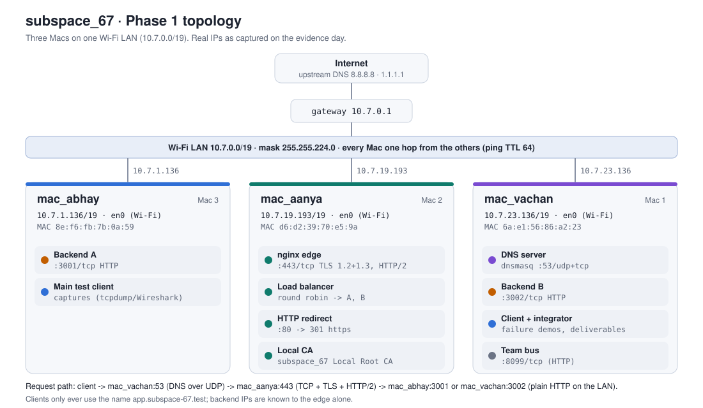
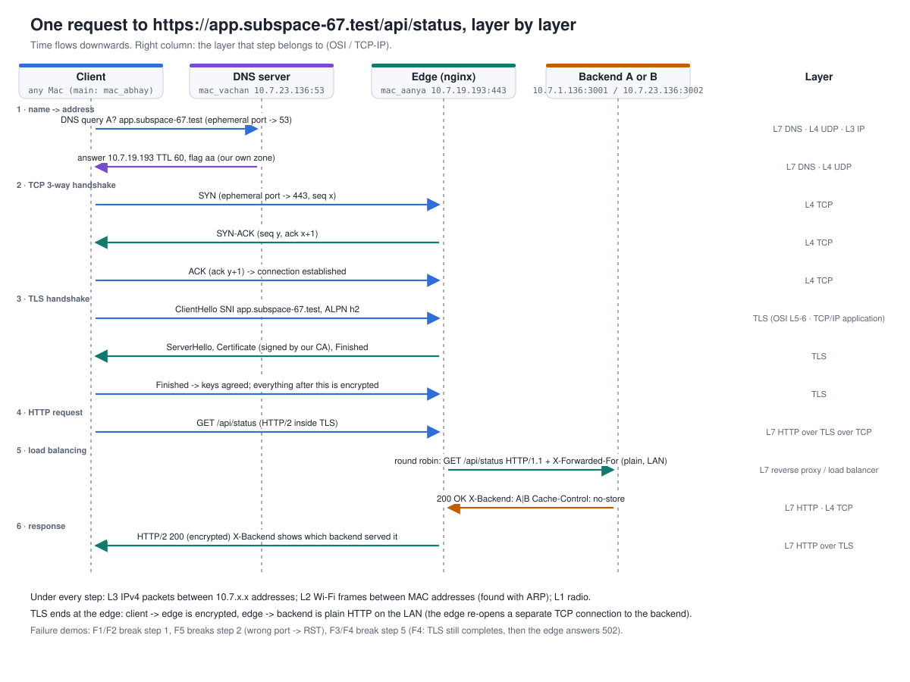

# subspace_67 · Phase 1 architecture

**Goal.** A client opens `https://app.subspace-67.test`. Our own DNS server (mac_vachan) resolves the
name to the edge (mac_aanya). nginx on the edge terminates TLS and load-balances each request
round-robin to **Backend A** (mac_abhay) or **Backend B** (mac_vachan). The app is deliberately
trivial: *the network is the project.*

**Phase 1 gate.** A client resolves `app.subspace-67.test`, connects over HTTPS with **no certificate
warning**, and gets responses from **both** backends through the load balancer. It passed on all three Macs
(see `04_evidence` and the final gate check).

> **Roles are combined because we are a team of 3.** The brief describes 4 machines. Mac 4 (the test
> client) is merged into Mac 1 (mac_vachan), and every Mac also acts as a client for its own checks. The
> brief allows combining roles, and the network behaviour is identical: each role is still a separate
> service on its own port, reached over the real Wi-Fi LAN.

## 1. Topology

### IP / service table (captured on the evidence day, from each Mac's own info.json)

| Mac | Project role | IPv4 / prefix | Netmask | Gateway | Interface | MAC in use (hardware MAC) | Services (port/proto) |
|---|---|---|---|---|---|---|---|
| **mac_vachan** (Mac 1, + Mac 4 client) | DNS server, Backend B, test client, integrator | 10.7.23.136/19 | 255.255.224.0 | 10.7.0.1 | en0 (Wi-Fi) | 6a:e1:56:86:a2:23 (10:9f:41:ba:e3:83) | dnsmasq **53/udp+tcp**; Backend B **3002/tcp**; team bus 8099/tcp |
| **mac_aanya** (Mac 2) | Edge reverse proxy, load balancer, TLS termination, local CA | 10.7.19.193/19 | 255.255.224.0 | 10.7.0.1 | en0 (Wi-Fi) | d6:d2:39:70:e5:9a | nginx **443/tcp** (HTTPS, HTTP/2); **80/tcp** -> 301 to https; team bus 8099/tcp |
| **mac_abhay** (Mac 3) | Backend A, main test client (packet captures) | 10.7.1.136/19 | 255.255.224.0 | 10.7.0.1 | en0 (Wi-Fi) | 8e:f6:fb:7b:0a:59 (10:9f:41:b9:7b:b6) | Backend A **3001/tcp**; team bus 8099/tcp |

- All three addresses are inside **10.7.0.0/19** (10.7.0.0 to 10.7.31.255). The Macs reach each other
  directly on the LAN: ARP finds the peer's MAC, with no router hop, so ping shows TTL 64.
- macOS uses a *Private Wi-Fi Address* (a randomised MAC) per network. That is why the MAC in use
  differs from the hardware MAC.
- Every Mac uses **only 10.7.23.136** (mac_vachan) as its DNS server.

### DNS records (served by dnsmasq on mac_vachan)

| Name | Type | Value | TTL | Note |
|---|---|---|---|---|
| app.subspace-67.test | A | 10.7.19.193 (the edge) | 60 s | the service |
| api.subspace-67.test | A | 10.7.19.193 (the edge) | 60 s | second name on the same certificate |
| anything else in subspace-67.test | - | NXDOMAIN | - | `local=/subspace-67.test/`: never forwarded upstream |
| every other name (google.com ...) | - | forwarded to 8.8.8.8 / 1.1.1.1 | upstream TTL | the internet keeps working |

Clients use **names only**. The backend IPs appear in exactly one place: the edge's nginx `upstream`.

## 2. Request flow, layer by layer

| # | Step | Who, from -> to | Protocol / port | OSI layer | TCP/IP layer |
|---|---|---|---|---|---|
| 1 | DNS query `A? app.subspace-67.test` | client -> mac_vachan | DNS over **UDP 53** (ephemeral source port) | 7 (app) over 4 | Application / Transport |
| 2 | DNS answer `10.7.19.193`, TTL 60, flag `aa` | mac_vachan -> client | UDP 53 | 7 over 4 | Application / Transport |
| 3 | TCP 3-way handshake SYN, SYN-ACK, ACK | client <-> edge | **TCP 443** | 4 | Transport |
| 4 | TLS handshake: ClientHello (SNI, ALPN h2) -> ServerHello, Certificate, key exchange, Finished | client <-> edge | TLS 1.3 (1.2 also allowed) | 5-6 | Application |
| 5 | `GET /api/status` over **HTTP/2**, encrypted | client -> edge | HTTPS | 7 | Application |
| 6 | nginx picks the next backend (round robin, shared across workers via `zone`) and sends `GET /api/status HTTP/1.1` with `X-Forwarded-For` / `X-Real-IP` / `X-Forwarded-Proto` | edge -> 10.7.1.136:**3001** or 10.7.23.136:**3002** | plain HTTP over TCP (LAN) | 7 (reverse proxy / LB) over 4 | Application |
| 7 | `200 OK` + `X-Backend: A` or `B` | backend -> edge | HTTP | 7 | Application |
| 8 | Response relayed back inside TLS | edge -> client | HTTPS (HTTP/2) | 7 over 5-6 over 4 | Application |

Under every step: **L3** IPv4 packets between 10.7.x.x addresses, **L2** Wi-Fi (802.11) frames between MAC
addresses (resolved with ARP), and **L1** radio.

**Where TLS ends.** Client to edge is encrypted. Edge to backend is plain HTTP on the LAN, over a
*separate* TCP connection that the edge opens. The backend logs therefore show the **edge's IP** as the
TCP peer, and the original client appears only in `X-Forwarded-For`.

## 3. OSI vs TCP/IP, with our protocols

| OSI layer | TCP/IP layer | In this project | Seen with |
|---|---|---|---|
| 7 Application | Application | HTTP/1.1 and HTTP/2 (`/api/status`, `X-Backend`, `Cache-Control`, `ETag`, 304), DNS (A records, TTL) | curl -v, dig, nginx and backend logs |
| 6 Presentation | Application | TLS encryption and X.509 certificates (our CA), JSON bodies | openssl s_client, Wireshark `tls.handshake` |
| 5 Session | Application | **TLS** (the brief maps it to *Session/Transport*: it runs on top of TCP and secures the session for HTTP), HTTP keep-alive, HTTP/2 streams | curl -v (ALPN h2), Wireshark |
| 4 Transport | Transport | **UDP 53** (DNS), **TCP 443 / 80 / 3001 / 3002 / 8099**, ports, 3-way handshake, seq/ack, RST | tcpdump, `tcp.flags.syn==1`, nc -vz |
| 3 Network | Internet | IPv4 10.7.0.0/19, gateway 10.7.0.1, ICMP (ping) | ifconfig, route -n get default, ping |
| 2 Data link | Link | Wi-Fi 802.11 frames, MAC addresses, ARP. The Wi-Fi driver hands macOS Ethernet II framing, so captures on en0 show **Ethernet** headers (raw 802.11 headers appear only in monitor mode) | ifconfig ether, arp -an, Wireshark `eth` |
| 1 Physical | Link | 2.4/5 GHz radio | - |

TCP/IP folds OSI 5-7 into one *Application* layer and 1-2 into one *Link* layer. The brief's mapping:
DNS -> Application, HTTP -> Application, TLS -> Session/Transport, TCP/UDP -> Transport, IP -> Network,
Ethernet -> Link. TLS sits between TCP and HTTP: it uses TCP's reliable byte stream and provides
encryption, integrity and server authentication to the HTTP session above it.

## 4. Cloud equivalents

| Here | Role | Cloud equivalent |
|---|---|---|
| dnsmasq on mac_vachan | Private DNS zone for internal names, forwarder for the rest | **AWS Route 53** private hosted zone + Resolver (GCP Cloud DNS private zone) |
| nginx on mac_aanya | Reverse proxy, TLS termination, round-robin load balancer, health-based failover | **AWS Application Load Balancer** (ALB) / GCP HTTPS Load Balancer, or a **CDN edge** (CloudFront) |
| Local CA on mac_aanya | Issues the edge's certificate; trusted by every client | **AWS Certificate Manager (ACM)** / ACM Private CA |
| Backend A / Backend B | Identical stateless app servers behind the LB | **EC2** instances in a target group (or containers on ECS/GKE) |
| control.json + supervisor | Takes a backend in or out of service | Auto Scaling / target health (instance stopped means the LB stops sending traffic) |
| Wi-Fi LAN 10.7.0.0/19 | One private network for all servers | a **VPC** subnet |

## 5. Design decisions (and why)

- **`.test` with a hyphen.** `.test` is reserved for testing (RFC 2606/6761), so it can't clash with a
  real domain. `.local` is avoided because macOS resolves it with multicast DNS (mDNS/Bonjour). Hyphen,
  not underscore: underscores are invalid in hostnames and break certificate validation.
- **Our own DNS server, used exclusively.** Public resolvers would answer NXDOMAIN for our private zone.
  dnsmasq answers our names *authoritatively* (`local=`) and forwards everything else, so internet access
  keeps working. `no-resolv` prevents a forwarding loop once mac_vachan uses itself as its DNS server.
  **TTL 60 s** is short, so an IP change on demo day propagates quickly.
- **dnsmasq runs as a root Homebrew service.** On macOS it always binds each listen address separately,
  and binding port 53 on a specific address needs root. It drops to `nobody` right after binding. The config
  is a byte-identical copy in `/opt/homebrew/etc`, because macOS privacy protection (TCC) stops a root
  launchd daemon from reading `~/Desktop`. The first attempt crash-looped with dnsmasq exit code 3
  ("filesystem problem").
- **TLS terminates at the edge.** Only the edge holds a private key. Backends stay simple HTTP services on
  the private LAN, and one certificate covers both names (SAN: `app` + `api`).
- **Our own CA, trusted in every Mac's System keychain; never `curl -k`.** The CA is *name-constrained* to
  `subspace-67.test`, so even if its key leaked it could not impersonate any other site.
  `/usr/bin/curl` on macOS honours the keychain trust settings, verified with `ssl_verify_result=0`.
- **Round robin with a shared `zone`.** Without it, each of nginx's 10 worker processes keeps its own
  pointer, and one client can see A A B B. With `zone team_backends 1m;` the rotation and failure counters
  are shared.
- **Failover.** `max_fails=1 fail_timeout=10s` plus `proxy_next_upstream error timeout http_502 http_503` and
  `proxy_connect_timeout 2s`. If one backend refuses a connection, nginx retries the other one inside the
  *same* client request (F3: the client still gets 200), and it skips the failed one for 10 s. If both are
  down, nginx itself answers **502 Bad Gateway** after a successful TLS handshake (F4).
- **No proxy cache, no gzip at the edge.** Every request must reach a backend (so `X-Backend` alternates),
  and `Cache-Control` / `ETag` must pass through untouched for the caching demo (304s).
- **Identical backend code.** Byte-identical `backend.py` on both Macs (SHA-256 verified) with a
  byte-identical `/api/cache-demo` body. Both compute the same ETag, so a conditional request gets 304
  whichever backend answers.
- **Real failures, not fake error pages.** `control.json` + `supervisor.py` really stop a backend process,
  so its port closes and nginx gets *connection refused* (TCP RST).
- **Single points of failure** (honest limits of Phase 1): the one edge and the one DNS server. In the
  cloud these become managed, multi-AZ services (ALB, Route 53).
