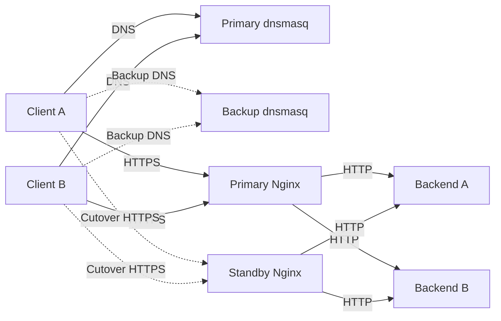

# Subspace 67 Windows Docker lab

## Run both phases

Open Docker Desktop and wait for its engine to start. Double-click Run-Lab.cmd, or run this command from the lab directory in Windows PowerShell.

    powershell.exe -NoProfile -ExecutionPolicy RemoteSigned -File .\Run-Lab.ps1

This process-scoped execution policy applies only to this invocation. The script starts the lab, waits for trusted HTTPS, and runs both phases. See DEMO.md for the live runbook and PHASE2-REPORT.md for the report and evidence checklist.

## Part 1. Baseline lab

Run from this directory in PowerShell with Docker Desktop running in Linux container mode.

```powershell
.\Start-Lab.ps1
docker compose -f compose.json exec -T client-a dig +short app.subspace-67.test
docker compose -f compose.json exec -T client-b dig +short api.subspace-67.test
docker compose -f compose.json exec -T client-a curl -fsSi https://app.subspace-67.test/api/status
docker compose -f compose.json exec -T client-a curl -fsSi https://app.subspace-67.test/api/status
```

The expected DNS answer is `10.67.10.10`. The two HTTPS responses should identify different backends with `X-Backend`. Each client trusts the lab CA through its own trust store.




| Role | Client network | Backend network |
|---|---|---|
| Primary DNS | 10.67.10.53 | |
| Backup DNS | 10.67.10.54 | |
| Primary edge | 10.67.10.10 | 10.67.20.10 |
| Standby edge | 10.67.10.20 | 10.67.20.20 |
| Backend A | | 10.67.20.11:3001 |
| Backend B | | 10.67.20.12:3002 |
| Client A | 10.67.10.101 | |
| Client B | 10.67.10.102 | |

The lab uses two private /24 bridges. Client traffic goes to the local DNS cache, then to primary or backup dnsmasq. Clients connect to the edge over HTTPS. Nginx terminates TLS and proxies HTTP to a backend over the second bridge. The Compose files publish no host ports.

`backend.py` is copied from the original project at commit `c9c04f69560ef4a4c46580fc7535c9588abd3c35`. Runtime keys are generated locally. Keep `runtime` out of submissions.

## Verified run

Both automated phases completed on 24 November 2026. The checked-in baseline is under verified-evidence/. The launcher writes fresh transcripts, a packet capture, and startup output to evidence/ and launcher.log. See [DEMO.md](DEMO.md) for live grading, [REQUIREMENTS.md](REQUIREMENTS.md) for the rubric mapping, [PHASE2-REPORT.md](PHASE2-REPORT.md) for measured outcomes, and [VIVA.md](VIVA.md) for rehearsal. The evaluator leads the final troubleshooting task and individual viva.


To stop the lab, run `docker compose -f compose.json --profile phase2 down`.
